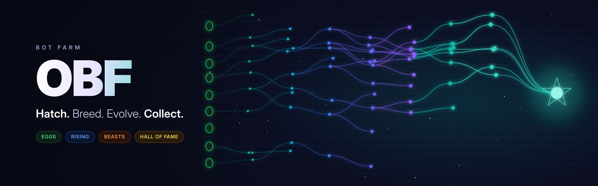
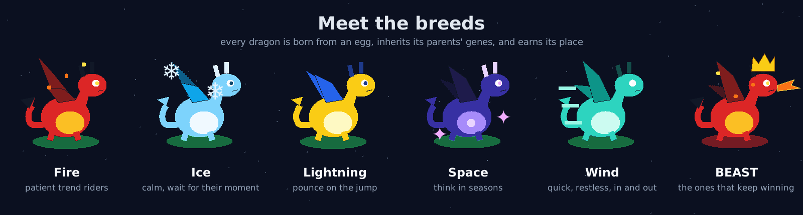

<b>Hatch a farm of little dragons. Let them compete, breed and evolve. Keep the legends.</b>

## Getting started
- **Windows:** download the latest release zip, extract the whole folder, double-click **Run OBF.bat** (or **OBF.pyw**)
- **Mac / Linux:** `python3 main.py` (Python 3.8 or newer with Tkinter)

New versions appear inside the app as an **Update** button. Nothing installs until you say yes, and
**Tools > Undo last update** always takes you back.

---

## From egg to legend
Every dragon climbs the same ladder, and the farm sorts them into dens, each with its own colour:

| Den | Who lives there |
|---|---|
| **Eggs** | Newborns still hatching and learning the ropes |
| **Rising** | Young dragons starting to prove themselves |
| **BEASTS** | The dominant ones, winning again and again |
| **Hall of Fame** | Your hand-picked champions. Only you decide who gets in |

Eggs crack open when they hatch and new BEASTS let out a roar. Every dragon has **XP, health and power**, and earns
**badges** along the way. A pulse strip above the farm shows births, retirements, the current season and the dragon
of the hour.

## The breeds
More than twenty instincts, each with its own look: **fire** dragons ride long trends, **ice** dragons wait calmly for
their moment, **lightning** dragons pounce, **space** dragons think in seasons, and **wind** dragons are the quick,
restless breed that darts in and out. Every dragon also carries its own mix of genes:

- **Studies** that vote for or against acting, and a **bigger-picture** sense that has to agree first
- **Never-rules**: things it refuses to do, each one graded in hindsight; useful rules spread, costly ones fade
- **Pace, patience and exits** that adapt to calm or wild times, and **confidence** that scales how boldly it acts
- **Memory**: what it's bad at, which seasons suit it, and every lesson from its tests

Each layer is graded on its own, and children inherit the evidence.

## Breeding
- **Eggs from winners**: the strongest dragons lay eggs, copies of themselves with small mutations
- **Crossbreeding**: two parents produce a child that mixes both sets of genes. Pair your favourites yourself
- **Royal and silver eggs**: royal eggs carry your bloodlines, silver eggs hatch famous breeds from history
- **Islands**: the farm splits into islands that breed apart and only swap a champion now and then
- **Elders**: great dragons that leave pass their wisdom on to future eggs
- **Seasons**: every season has a champion, and it wakes up again when its season returns
- **Mutation memory**: the farm notices which kinds of change make winners, and makes more of them
- **Natural selection**: dragons that keep failing rest, then retire to make room

## Training
- **Free roam**: switch it on and the farm wanders off to train by itself. It picks its own journeys, sends dragons on
  trials and small practice farms, and brings every lesson home. A live screen shows where it is and what it found.
  Wind dragons get journeys of their own.
- **The lab**: a farm of wind dragons only, learning on its own in real time, breeding minute by minute and sending
  its best graduates to your farm.
- **Training camp**: send a whole farm through a long journey several times over, then give the best a final exam
  on ground they've never seen. Graduates can join your farm or your Library.
- **Trials**: put any single dragon to the test, with a bad-luck test and a tougher-conditions test.
- **The slow farm**: a second, separate farm of slow, patient dragons that think in days instead of minutes.

## Everything the farm has learned
Open **Farm knowledge** to see it all at a glance: ability meters for the rules, instincts, seasons, elders and
breeding lessons your farm has mastered, and a grid of every lesson with the evidence behind it. Save it as a
**book**, keep as many books as you like, and pick any lessons to teach another farm.

## See and edit what they learned
Open any dragon's card to see its rules with the evidence behind each one, change whatever you like, and hatch your
edit as its child. Or design an egg from scratch.

## Collect them all
Press **Catch!** on any dragon to keep it in your **Library**, or drag it straight onto the Library or Hall of Fame.

- Every caught dragon gets a name, a rarity from **Common** to **Legendary**, and the occasional one is **shiny**
- Champions are re-checked every night; the ones losing their edge turn **rusty**
- Build a **team of up to 6**, compare two dragons side by side, export your favourites to a readable file, and
  import other people's dragons to see if they survive on your farm

## The farm never forgets
Close the app and come back later: the farm picks up exactly where it left off. Watch a **farm replay** of how the
dens grew, and get a **weekly report** of what it learned.

## Make it yours
- Dragons, simple cards or a plain list; full, light or no animation; a compact layout
- Dark and light themes, custom sounds, keyboard shortcuts, a short guided tour
- Farm presets, settings profiles, one-click backup and restore
- Farm size up to 200, learning spread over several processor cores, and it goes quiet when minimised

## Your data
Everything stays on your computer in `~/.obf/` (Windows: `C:\Users\<you>\.obf`). **File > Open data folder** opens it.

## Support the farm
OBF is free and made in spare time. If you'd like to help the farm grow, you can support it on
**[GitHub Sponsors](https://github.com/sponsors/kefirman9000)**: every bit goes into new breeds, new tricks and more time
to build them. Starring the repo and sharing your best dragons helps too.

## License
Copyright © 2026 kefirman9000. All rights reserved. OBF is free to use; see [LICENSE](LICENSE) for what is and isn't
allowed. It's provided **as is**, without warranty of any kind, and you're responsible for how you use it, including
any accounts or services you connect to it.

Found a security problem? Please report it privately; see [SECURITY.md](SECURITY.md).
